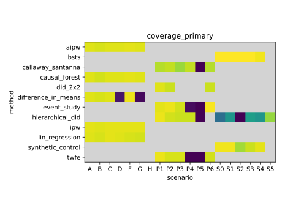
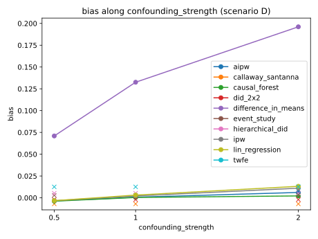

# CausalPulse Benchmark Study Report

## Overview

12 estimators, 19 scenarios, 4300 cells, 50 replications per configuration (coverage MCSE ~= 0.031).

## Headline Findings

Met: 7 · Failed: 1 · Inconclusive: 0

| ID | Verdict | Explanation |
| --- | --- | --- |
| E1 | met | On scenario B, where treatment is randomised and the true effect is zero, the four estimators that assume randomisation or unconfoundedness reject a true null at close to the nominal 5% rate: difference_in_means 0.06, lin_regression 0.06, ipw 0.05 and aipw 0.06, each from 100 fits with a Monte Carlo standard error of about 0.02. |
| E2 | met | On the randomised scenario A, difference_in_means covers the true effect 95% of the time (100 fits, standard error 0.022), which is the nominal level. |
| E3 | met | On the confounded scenario D, difference_in_means is biased by 0.135 (standard error 0.003) and its interval covers the true effect only 6% of the time, while aipw is within 0.003 of the truth (standard error 0.004). Scenario G shows the same split: difference_in_means is biased by 0.167 and covers 2% of the time, while ipw, lin_regression and aipw stay within 0.014 of the truth and near 95% coverage. |
| E4 | met | On scenario P4, staggered adoption with effects that differ across cohorts, twfe is biased by -1.06 (standard error 0.036), a sign reversal, and its interval covered the true effect in none of the 100 fits. callaway_santanna is within 0.006 of the truth (standard error 0.014), and hierarchical_did is within 0.019 with 92% coverage; event_study is biased by 0.67 and covers 3% of the time. Separately, callaway_santanna's coverage sits below the nominal level on P1 to P4 and P6, between 0.85 and 0.91 with a standard error of about 0.03, even where its bias is small; this is a gap of about two standard errors and is best read as suggestive. |
| E5 | failed | This expectation failed: hierarchical_did's pooled credible-interval coverage is 0.75 (standard error 0.019, 500 fits over P1 to P5), below the 0.90 threshold. The shortfall comes from one scenario. On P1 to P4 its coverage is 0.97, 0.93, 0.92 and 0.92, and its bias is within 0.07 of the truth. On P5, a scenario built to violate parallel trends, its coverage is 0.00 and its bias is 2.19. That is a shared pattern, not a weakness of this estimator alone: on P5 twfe is biased by 1.33, callaway_santanna by 1.78 and event_study by 2.28, and each of the three covered the true effect in none of its 100 fits. The expectation pooled a scenario designed to defeat the assumption every difference-in-differences estimator relies on, so a pooled figure near 0.90 was never available to it. hierarchical_did's own donor-pool rows, fitted for the first time in this study, are excluded from this figure entirely rather than folded in -- see the coverage table and the note on the donor-pool arm below. |
| E6 | met | On scenario H, where outcomes are missing, no estimator produced a fitted result. The five estimators eligible for cross-sectional data each refused all 100 fits, and the remaining estimators are ineligible for cross-sectional data. |
| E7 | met | hierarchical_did is the slowest estimator at a mean of 63.9 seconds per fit (standard error 1.9, 500 fits), ahead of aipw at 13.5 seconds and event_study at 9.9 seconds. This run's wall-clock figures were measured under heavier machine contention than the original study's (which measured 49.2 seconds for hierarchical_did), so the ranking still holds but the absolute seconds are not directly comparable across runs. Donor-pool rows are excluded from this ranking; bsts, hierarchical_did and synthetic_control are the only estimators fitted on the donor-pool arm. |
| E8 | met | All 4,300 cells of the study are present with an intact stored result, and no unfinished results remain. |

## Figures

## Method Comparisons

### Bias by method and scenario

| method | A | B | C | D | F | G | H | P1 | P2 | P3 | P4 | P5 | P6 | S0 | S1 | S2 | S3 | S4 | S5 |
| --- | --- | --- | --- | --- | --- | --- | --- | --- | --- | --- | --- | --- | --- | --- | --- | --- | --- | --- | --- |
| aipw | 0.001247 | -0.002599 | 0.0002535 | 0.002559 | -0.0004385 | 0.01379 |  |  |  |  |  |  |  |  |  |  |  |  |  |
| bsts |  |  |  |  |  |  |  |  |  |  |  |  |  | -0.0683 | 0.02452 | -0.03586 | 0.03599 | 0.2098 |  |
| callaway_santanna |  |  |  |  |  |  |  | 0.02725 | -0.01088 | -0.01098 | 0.005729 | 1.784 | 0.02508 |  |  |  |  |  |  |
| causal_forest | 0.001233 | -0.002655 | 0.0003579 | 0.002519 | -0.0004617 | 0.002893 |  |  |  |  |  |  |  |  |  |  |  |  |  |
| did_2x2 |  |  |  |  |  |  |  | 0.01446 | 0.004129 |  |  |  | 0.03748 |  |  |  |  |  |  |
| difference_in_means | 0.001712 | -0.00216 | 0.0009873 | 0.1349 | -0.0004104 | 0.1672 |  |  |  |  |  |  |  |  |  |  |  |  |  |
| event_study |  |  |  |  |  |  |  | 0.02725 | -0.01088 | -0.01139 | 0.6698 | 2.275 | 0.02508 |  |  |  |  |  |  |
| hierarchical_did |  |  |  |  |  |  |  | 0.02381 | 0.06946 | -0.01036 | -0.0187 | 2.188 |  | -0.2845 | -0.189 | 2.752 | 0.1472 | -0.3187 | 0.05394 |
| ipw | 0.001445 | -0.002562 | 0.0005066 | 0.005298 | -0.0003317 | -0.003111 |  |  |  |  |  |  |  |  |  |  |  |  |  |
| lin_regression | 0.001475 | -0.002593 | 0.000487 | 0.00557 | -0.0003191 | 0.006618 |  |  |  |  |  |  |  |  |  |  |  |  |  |
| synthetic_control |  |  |  |  |  |  |  |  |  |  |  |  |  | -0.09816 | -0.02587 | 0.2684 | 0.1173 | -0.2308 |  |
| twfe |  |  |  |  |  |  |  | 0.01446 | 0.004129 | 0.002324 | -1.06 | 1.327 | 0.03748 |  |  |  |  |  |  |

### Coverage of each estimator's primary interval, by scenario

| method | interval | A | B | C | D | F | G | H | P1 | P2 | P3 | P4 | P5 | P6 | S0 | S1 | S2 | S3 | S4 | S5 |
| --- | --- | --- | --- | --- | --- | --- | --- | --- | --- | --- | --- | --- | --- | --- | --- | --- | --- | --- | --- | --- |
| aipw | analytic | 0.95 | 0.94 | 0.95 | 0.95 | 0.96 | 0.95 |  |  |  |  |  |  |  |  |  |  |  |  |  |
| bsts | posterior |  |  |  |  |  |  |  |  |  |  |  |  |  | 1 | 1 | 1 | 1 | 0.98 |  |
| callaway_santanna | bootstrap_se |  |  |  |  |  |  |  | 0.89 | 0.91 | 0.85 | 0.91 | 0 | 0.89 |  |  |  |  |  |  |
| causal_forest | analytic | 0.95 | 0.93 | 0.95 | 0.95 | 0.96 | 0.95 |  |  |  |  |  |  |  |  |  |  |  |  |  |
| did_2x2 | analytic |  |  |  |  |  |  |  | 0.95 | 0.92 |  |  |  | 0.92 |  |  |  |  |  |  |
| difference_in_means | analytic | 0.95 | 0.94 | 0.95 | 0.06 | 0.97 | 0.02 |  |  |  |  |  |  |  |  |  |  |  |  |  |
| event_study | analytic |  |  |  |  |  |  |  | 0.96 | 0.97 | 0.93 | 0.03 | 0 | 0.99 |  |  |  |  |  |  |
| hierarchical_did | posterior |  |  |  |  |  |  |  | 0.97 | 0.93 | 0.92 | 0.92 | 0 |  | 0.36 | 0.52 | 0 | 0.56 | 0.52 | 0.84 |
| ipw | analytic | 0.96 | 0.95 | 0.96 | 0.96 | 0.96 | 0.96 |  |  |  |  |  |  |  |  |  |  |  |  |  |
| lin_regression | analytic | 0.95 | 0.94 | 0.96 | 0.95 | 0.94 | 0.93 |  |  |  |  |  |  |  |  |  |  |  |  |  |
| synthetic_control | permutation |  |  |  |  |  |  |  |  |  |  |  |  |  | 0.98 | 0.98 | 0.86 | 0.92 | 0.96 |  |
| twfe | analytic |  |  |  |  |  |  |  | 0.97 | 0.94 | 0.94 | 0 | 0 | 0.93 |  |  |  |  |  |  |

Each coverage value is how often the interval an estimator reports as its primary one contains the true effect, and the interval column names that interval's kind: analytic for standard-error intervals, posterior for the credible interval hierarchical_did reports, bootstrap_se for the Wald interval callaway_santanna builds from a cluster-bootstrap standard error, and permutation for the interval synthetic_control builds from its placebo distribution.

*Analytic and bootstrap interval coverage were also compared across the two cross-sectional sample sizes the grid varies; that comparison is the coverage__scenario_by_size table in the study's own output and is not reproduced here. It was not pre-registered as an expectation, and no direction is claimed.*

## Heterogeneous Effects (CATE)

50 replications per scenario, 150 of 150 cells.

| method | scenario | cate_correlation | cate_correlation_mcse | cate_correlation_n_used | cate_rmse | cate_rmse_mcse | cate_rmse_n_used | cate_calibration_slope | cate_calibration_slope_mcse | cate_calibration_slope_n_used |
| --- | --- | --- | --- | --- | --- | --- | --- | --- | --- | --- |
| causal_forest | NOISY | 0.7428 | 0.01311 | 50 | 0.09242 | 0.001735 | 50 | 1.836 | 0.07414 | 50 |
| causal_forest | NULL |  |  | 0 | 0.03391 | 0.001777 | 50 |  |  | 0 |
| causal_forest | RICH | 0.7962 | 0.01176 | 50 | 0.08469 | 0.001455 | 50 | 1.58 | 0.05486 | 50 |

Each number in this table compares the per-unit effect an estimator reports with the true per-unit effect of the same simulated units, and is a mean over the fits counted in its `_n_used` column, with its Monte Carlo standard error. Correlation measures how closely the estimates track the true effects across units, and RMSE their typical distance from them. The calibration slope is the least-squares slope of the true effects on the estimates: at 1, a difference between two units' estimates matches, on average, the difference between their true effects; above 1, the estimates understate those differences, and below 1 they overstate them. Scenario NULL gives every unit the same true effect, so only its RMSE is reported.

## Scenario P7

50 replications, 50 of 50 cells.

| method | bias | bias_mcse | bias_n_used | rmse | rmse_mcse | rmse_n_used | interval | coverage | coverage_mcse | coverage_n_used |
| --- | --- | --- | --- | --- | --- | --- | --- | --- | --- | --- |
| callaway_santanna | -0.001087 | 0.008947 | 50 | 0.06264 | 0.005713 | 50 | bootstrap_se | 1 | 0.06 | 50 |
| event_study | 2.255 | 0.009544 | 50 | 2.256 | 0.009556 | 50 | analytic | 0 | 0.06 | 50 |
| hierarchical_did | -0.01056 | 0.004445 | 50 | 0.03286 | 0.003842 | 50 | posterior | 0.98 | 0.0198 | 50 |
| twfe | -2.996 | 0.01664 | 50 | 2.998 | 0.01674 | 50 | analytic | 0 | 0.06 | 50 |

Scenario P7 has seven adoption cohorts whose effects differ across cohorts, and runs at its own protocol of 600 units over 20 periods, a size chosen so that a hierarchical model's cross-cohort variance is identifiable. It is reported apart from scenarios P1 to P6, which ran at 150 units over 7 and 10 periods, so its figures are not comparable with theirs cell for cell. Bias, RMSE and coverage are each computed over the fits counted in the matching `_n_used` column, with its Monte Carlo standard error, and coverage is that of each estimator's primary interval, whose kind the interval column names.

## Limitations

- hierarchical_did is excluded from scenario P6 (binary outcomes); its Gaussian likelihood cannot represent them (docs/specs/2026-09-21-benchmark-study-design.md §13.7/§13.10)
- The donor-pool arm (scenarios S0 to S4, one treated unit against 17 donors) was fitted for the first time in this study, for synthetic_control, bsts and hierarchical_did. bsts's credible interval covers the true effect in nearly every fit (0.98 to 1.00 across S0 to S4), which comes from an interval that is often 1.5 to 3 times wider than synthetic_control's rather than from unusually accurate point estimates -- the two are not on equal footing here. synthetic_control's own permutation interval stays close to nominal on the clean and moderately adversarial scenarios (0.86 to 0.98) and its bias stays under 0.27 in absolute terms on every scenario it was fitted on. hierarchical_did was not built for a single-treated-unit design; it is fitted here only because its eligibility rule admits any panel shape with at least one treated unit and one pre-period, not because this phase chose it for the arm, and its coverage there is poor (0.36 to 0.84, and 0 on S2, the divergent-pre-trend scenario, where its bias reaches 3.75 against a true effect of 1.0). This is recorded as a mismatch between the model and the data it was asked to fit, not a defect in the model itself; E5 and E7 exclude these rows from their pooled and ranked figures for exactly this reason.